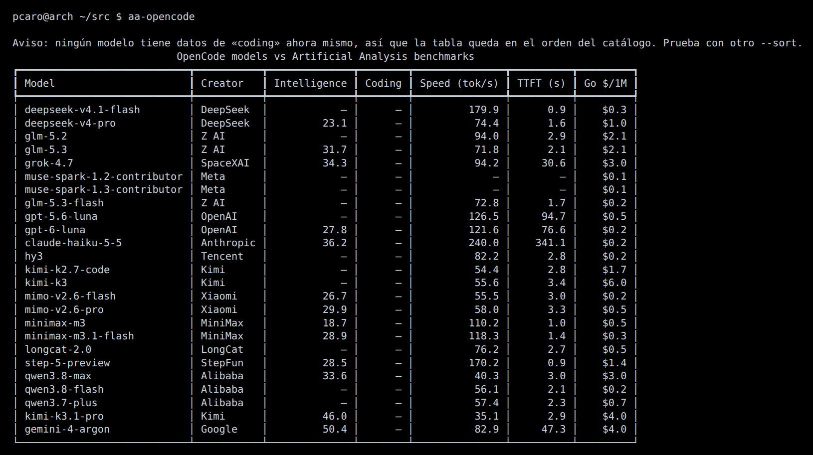

# aa-opencode

Compara los modelos que ofrece [OpenCode](https://opencode.ai) con los benchmarks de
[Artificial Analysis](https://artificialanalysis.ai): inteligencia, velocidad y precio, en
una sola tabla.



## Requisitos

- Python 3.10+
- Una API key gratuita de Artificial Analysis
  ([crear cuenta](https://artificialanalysis.ai/login) → generar API key)

## Instalación

```bash
uv tool install git+https://github.com/pcaro/aa-opencode
```

O, para desarrollo:

```bash
git clone https://github.com/pcaro/aa-opencode
cd aa-opencode
uv sync
```

## Uso

La API key se lee, por orden de prioridad, de:

1. El parámetro `--api-key`
2. La variable de entorno `ARTIFICIAL_ANALYSIS_API_KEY`
3. La variable de entorno `AA_API_KEY`

```bash
# Salida humana (por defecto), ordenada por índice de código
aa-opencode

# Ordenar por precio, velocidad o índice de código
aa-opencode --sort price
aa-opencode --sort speed
aa-opencode --sort coding

# Catálogo Zen en vez del Go (que es el de por defecto)
aa-opencode --catalog zen

# Salida JSON para programas externos
aa-opencode --format json

# Pasar la key explícitamente
aa-opencode --api-key "tu-key"
```

### Opciones

| Opción | Por defecto | Descripción |
| --- | --- | --- |
| `--api-key` | — | API key de Artificial Analysis. Tiene prioridad sobre las variables de entorno. |
| `--catalog {go,zen}` | `go` | Catálogo de modelos de OpenCode que se compara. También determina la fuente del precio y las etiquetas de la salida. |
| `--opencode-url` | — | Endpoint de modelos propio. Anula `--catalog`. |
| `--format {human,json}` | `human` | Formato de salida. |
| `--sort` | `coding` | Criterio de orden: `coding`, `intelligence`, `speed`, `ttft`, `price` o `name`. |
| `--top` | `3` | Modelos por categoría en el ranking calidad/precio. |
| `--show-unmatched` | — | Lista los modelos sin datos en Artificial Analysis (solo en la salida humana). |

## Salida

Las etiquetas de precio de las tres tablas llevan el nombre del catálogo elegido, así que
con `--catalog zen` verás `Zen $/1M` y `precio Zen` en lugar de las de Go.

### Tabla principal

Un modelo de OpenCode por fila, con los datos de Artificial Analysis y el precio que
cobra OpenCode. Ordenada por índice de código por defecto, que es la métrica que más se
acerca a para qué se usa OpenCode.

```text
Aviso: ningún modelo tiene datos de «coding» ahora mismo, así que la tabla queda en el orden del catálogo. Prueba con otro --sort.
                           OpenCode models vs Artificial Analysis benchmarks
┏━━━━━━━━━━━━━━━━━━━━━━━━━━━━┳━━━━━━━━━━━┳━━━━━━━━━━━━━━┳━━━━━━━━┳━━━━━━━━━━━━━━━┳━━━━━━━━━━┳━━━━━━━━━┓
┃ Model                      ┃ Creator   ┃ Intelligence ┃ Coding ┃ Speed (tok/s) ┃ TTFT (s) ┃ Go $/1M ┃
┡━━━━━━━━━━━━━━━━━━━━━━━━━━━━╇━━━━━━━━━━━╇━━━━━━━━━━━━━━╇━━━━━━━━╇━━━━━━━━━━━━━━━╇━━━━━━━━━━╇━━━━━━━━━┩
│ deepseek-v4.1-flash        │ DeepSeek  │            — │      — │         179.9 │      0.9 │    $0.3 │
│ deepseek-v4-pro            │ DeepSeek  │         23.1 │      — │          74.4 │      1.6 │    $1.0 │
│ glm-5.2                    │ Z AI      │            — │      — │          94.0 │      2.9 │    $2.1 │
│ glm-5.3                    │ Z AI      │         31.7 │      — │          71.8 │      2.1 │    $2.1 │
│ grok-4.7                   │ SpaceXAI  │         34.3 │      — │          94.2 │     30.6 │    $3.0 │
│ muse-spark-1.2-contributor │ Meta      │            — │      — │             — │        — │    $0.1 │
│ muse-spark-1.3-contributor │ Meta      │            — │      — │             — │        — │    $0.1 │
│ glm-5.3-flash              │ Z AI      │            — │      — │          72.8 │      1.7 │    $0.2 │
│ gpt-5.6-luna               │ OpenAI    │            — │      — │         126.5 │     94.7 │    $0.5 │
│ gpt-6-luna                 │ OpenAI    │         27.8 │      — │         121.6 │     76.6 │    $0.2 │
│ claude-haiku-5-5           │ Anthropic │         36.2 │      — │         240.0 │    341.1 │    $0.2 │
│ hy3                        │ Tencent   │            — │      — │          82.2 │      2.8 │    $0.2 │
│ …                          │ …         │            … │      … │             … │        … │       … │
└────────────────────────────┴───────────┴──────────────┴────────┴───────────────┴──────────┴─────────┘
```

Esta salida está capturada mientras Artificial Analysis recomputa el índice de código tras
el salto a v5, así que la columna Coding sale entera a `—` y la tabla queda en el orden del
catálogo. Cuando el índice vuelve, la tabla se ordena sola.


Un `—` significa que Artificial Analysis no publica ese dato para el modelo.

El Intelligence Index va por versiones mayores y **las puntuaciones no son comparables entre
versiones**: la versión vigente sale en el pie de la tabla (hoy `v5`). Además, Artificial
Analysis puntúa por tandas y recomputa índices enteros cuando cambia la metodología — el de
código, por ejemplo, se deriva de las evaluaciones del Intelligence Index y se queda vacío
mientras lo recalculan. Cuando el campo por el que ordenas no tiene ni un dato, la tool lo
avisa por stderr y deja la tabla en el orden del catálogo, en vez de fingir un orden.

### Ranking calidad/precio

Los tres modelos con mejor relación entre índice y precio de OpenCode, por categoría:
**Código** (índice de código), **Imágenes** (solo modelos multimodales) y **General**.

```text
                           Mejores calidad/precio (precio Go)
┏━━━━━━━━━━━┳━━━┳━━━━━━━━━━━━━━━━━━━━━━━━━━━━┳━━━━━━━━┳━━━━━━━━━━━━━━━━┳━━━━━━━━━━━━━━━━┓
┃ Categoría ┃ # ┃ Modelo                     ┃ Índice ┃ Precio Go $/1M ┃ Calidad/Precio ┃
┡━━━━━━━━━━━╇━━━╇━━━━━━━━━━━━━━━━━━━━━━━━━━━━╇━━━━━━━━╇━━━━━━━━━━━━━━━━╇━━━━━━━━━━━━━━━━┩
│ Código    │ 1 │ muse-spark-1.2-contributor │   58.6 │           $0.1 │            469 │
│ Código    │ 2 │ muse-spark-1.3-contributor │   58.6 │           $0.1 │            469 │
│ Código    │ 3 │ mimo-v2.5                  │   60.2 │           $0.2 │            344 │
│ Imágenes  │ 1 │ claude-haiku-5-5           │   36.2 │           $0.2 │            181 │
│ Imágenes  │ 2 │ mimo-v2.6-flash            │   26.7 │           $0.2 │            153 │
│ Imágenes  │ 3 │ gpt-6-luna                 │   27.8 │           $0.2 │            139 │
│ General   │ 1 │ claude-haiku-5-5           │   36.2 │           $0.2 │            181 │
│ General   │ 2 │ mimo-v2.6-flash            │   26.7 │           $0.2 │            153 │
│ General   │ 3 │ gpt-6-luna                 │   27.8 │           $0.2 │            139 │
└───────────┴───┴────────────────────────────┴────────┴────────────────┴────────────────┘
```

`Calidad/Precio` es índice ÷ precio por millón de tokens. Cuanto más alto, mejor.

### Buenas ofertas

Modelos donde OpenCode los cobra más baratos que el precio público de referencia. El
ahorro se calcula como (precio AA − precio OpenCode) ÷ precio AA.

```text
                Buenas ofertas Go (vs precio AA)
┏━━━━━━━━━━━━━━━━━┳━━━━━━━━━━━━━━━━┳━━━━━━━━━━━━━━━━┳━━━━━━━━━━┓
┃ Modelo          ┃ Precio AA $/1M ┃ Precio Go $/1M ┃ Ahorro % ┃
┡━━━━━━━━━━━━━━━━━╇━━━━━━━━━━━━━━━━╇━━━━━━━━━━━━━━━━╇━━━━━━━━━━┩
│ mimo-v2.5       │           $0.6 │           $0.2 │      69% │
│ longcat-2.0     │           $1.3 │           $0.5 │      60% │
│ deepseek-v4-pro │           $2.0 │           $1.0 │      50% │
└─────────────────┴────────────────┴────────────────┴──────────┘
```

El precio AA se calcula como blended 3:1 a partir del precio de input y output que publica
la API, que ya no lo da masticado.

### JSON

```json
{
  "source": "https://artificialanalysis.ai/",
  "generated_at": "2026-10-28T11:20:00.000000+00:00",
  "intelligence_index_version": 5,
  "opencode_url": "https://opencode.ai/inference/go/v1/models",
  "models": [
    {
      "opencode_id": "mimo-v2.6-pro",
      "matched": true,
      "name": "MiMo-V2.6-Pro",
      "slug": "mimo-v2-6-pro",
      "creator": "Xiaomi",
      "intelligence_index": 29.9,
      "coding_index": null,
      "output_tokens_per_second": 62.23,
      "time_to_first_token_seconds": 3.37,
      "price_blended_1m": 0.54375,
      "price_input_1m": 0.435,
      "price_output_1m": 0.87,
      "multimodal": true,
      "go_price_blended_1m": 0.54375,
      "go_price_input_1m": 0.435,
      "go_price_output_1m": 0.87
    }
  ]
}
```

`intelligence_index_version` es la versión mayor del índice con la que se calcularon las
puntuaciones de esa ejecución. Los campos `price_*` son el precio público de Artificial
Analysis y los `go_price_*` el que cobra OpenCode. Los modelos sin datos en Artificial
Analysis aparecen solo con `opencode_id` y `matched: false`.

## Cómo funciona

1. Consulta el endpoint de modelos de OpenCode: `https://opencode.ai/inference/go/v1/models`
   para el catálogo Go (por defecto) o `https://opencode.ai/zen/v1/models` para Zen.
2. Consulta la API gratuita de Artificial Analysis
   (`/api/v2/language/models/free`), paginada de 200 en 200: 4 peticiones por ejecución de
   las 100 diarias que da el plan Free.
3. Empareja cada modelo de OpenCode con su entrada en Artificial Analysis: slug exacto,
   luego la subcadena más corta y por último el conjunto de tokens idéntico.
4. Añade el precio de OpenCode, leído de [models.dev](https://models.dev) y convertido a
   precio blended 3:1 por millón de tokens.
5. Muestra la tabla, el ranking calidad/precio y las mayores diferencias de precio.

## Limitaciones

- **El emparejamiento es heurístico**, no hay tabla de equivalencias escrita a mano. Un
  modelo mal emparejado da números creíbles y equivocados, así que conviene mirar la fila
  cuando aparece un modelo nuevo en el catálogo.
- **Los TTFT hay que leerlos con pinzas.** Algunos modelos salen con tiempos de primer
  token de cientos de segundos, que son artefactos del momento de la medición (colas, rate
  limits) y no latencia real.
- **Ojo con las versiones del índice.** El Intelligence Index cambia de versión mayor cada
  pocos meses y las notas dejan de ser comparables entre versiones. El pie de la tabla
  indica la versión con la que se generó la salida; no compares capturas antiguas.
- **No hay histórico.** Cada ejecución es una foto del momento.
- **No comprueba disponibilidad.** Si un modelo está de baja, no se entera.
- El precio por millón de tokens es una referencia de catálogo, no tu factura.

## Atribución

El uso de la API gratuita de Artificial Analysis requiere atribución a
https://artificialanalysis.ai/. Los precios de OpenCode provienen de https://models.dev/.
